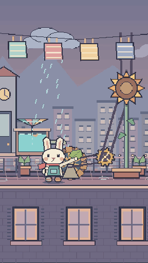
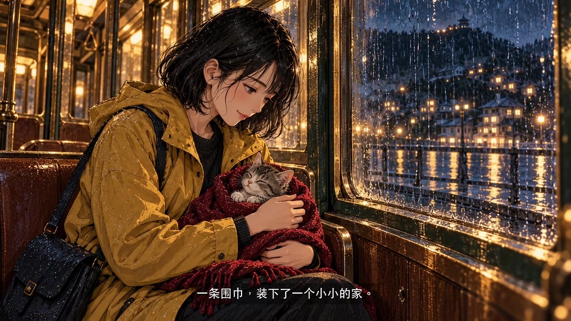

**目的**：帮助使用者运行、理解并扩展这套 AI 视频制作工作流。

# ai-video-marker

把创意交给 AI，按流程做一支可以修改、可以接续的视频。

这里包含 **Graph → Loop → Workflow → Agent → Skill → Standards** 六层制作方法，以及制作模板、本地工具和三个可独立运行的像素场景。简单任务直接从Workflow开始，复杂依赖/重复修订才启用Graph/Loop。AI组织阶段工作和调用工具，使用者确认创作方向与最终采用版本。

## 仓库里有什么

**9条内容流程（6正式、3候选） · 2条辅助流程 · 9项角色职责 · 10项技能 · 3个可运行像素场景 · 1个AI漫画成片展示 · 18个文字案例**。

| 你想了解什么 | 从这里进入 | 能拿到什么 |
|---|---|---|
| 先看效果、运行一支视频 | [漫画案例](#ai漫画案例雨夜最后一班电车)、[新手体验](#做你的第一支视频) | 约30秒漫画展示；默认36秒机器人短片可在本地重渲 |
| 换题材、做自己的故事 | [18个开场文案](examples/story-starters/README.md)、[9条制作流程](#一共有多少种制作流程) | 创作需求、分镜和阶段方法；新故事按路线适配实现 |
| 找图片、视频与音频 | [素材中心](assets/README.md)：[图片](assets/images/README.md) · [视频](assets/videos/README.md) · [音频](assets/audio/README.md) | 已公开素材实际按类型/模块归档，配置与来源正确引用；素材组不等于现成影片 |
| 理解AI怎么组织制作 | [六层方法](#六层如何配合)、[创作与接续](#从创意到交付如何推进与接续) | 分工、代表段迭代、动作与验收方法、跨窗口继续制作 |
| 找工具和项目模板 | [本地工具](#本地工具能做什么)、[制作模板](templates/README.md) | 项目初始化、像素12份工作表、渲染、音轨处理与检查 |

仓库同时提供**制作知识、可执行工具与作品展示**。各流程表中分别标明实际实现范围；生图、语音、图生视频和剪映等能力由使用者当前的助手与本机环境提供。



*《屋顶晒太阳》：小兔集雨、解开水轮卡点，带动齿轮花开放，最后同一屋顶共同活动。以上为16–30秒原速节选；[44秒完整带音乐视频](assets/videos/pixel-rooftop/preview.mp4)。示例直接抽取真实作品绘图代码，保留角色、层次、动作和镜头。*

**当前框架0.6.0**：包含Blender分层角色2.5D有限动画方法、连续平面揭示、公共制作入口与接续合同；实际工具能力见下方目录。此次补齐18个文字开场的九方向入口，未新增媒体。完整版本变化与验证见[升级说明](docs/FRAMEWORK_UPGRADE.md)和[验证记录](docs/VALIDATION.md)。

## AI漫画案例：雨夜最后一班电车

[](assets/videos/reference-comic/preview.mp4)

[▶ 查看或下载完整视频（约30秒，1080p，带原创配乐）](assets/videos/reference-comic/preview.mp4) · [制作说明](examples/reference-comic/README.md)

六幅新生成漫画讲述雨夜站台上的一次停留。实际制作路径是**运镜/字幕预合成 → 剪映添加片名并导出**，属于漫画有限运镜的混合制作展示；原素材和剪映工程没有随视频上传。想制作自己的案例，可沿[参考音轨与AI漫画流程](workflows/参考音轨与AI漫画剪映短视频制作.md)开始。

## 先挑一个案例：复制文字就能开场

[打开18个案例开场文案](examples/story-starters/README.md)，每个都有一句片头文案和一段可复制给AI的制作需求。可以直接在GitHub网页阅读，先挑题材，无需为阅读文案下载素材。

| 想做的方向 | 文字案例 |
|---|---|
| 温暖故事 | 没有收件人的信、把晚霞留到明天 |
| 像素短片 | 红绿灯休假一天、云朵面包店 |
| 定格动画 | 一枚纽扣的搬家、纸飞机的返航 |
| 古诗词学习 | 雪落在江面之前、竹子的回答 |
| 情绪诗词（候选流程） | 把没说完的话还给风、今晚允许自己慢一点 |
| 立体书剪纸（候选流程） | 借我一页海、星星住进了信封 |
| Blender分层角色 | [灯塔守望者的点头](examples/story-starters/README.md#13-灯塔守望者的点头)、[纸鹤停在指尖](examples/story-starters/README.md#14-纸鹤停在指尖) |
| 绘画世界（候选流程） | [窗中另一片海](examples/story-starters/README.md#15-窗中另一片海)、[书页背后的天空](examples/story-starters/README.md#16-书页背后的天空) |
| AI漫画剪映 | [给月亮修伞的人](examples/story-starters/README.md#17-给月亮修伞的人)、[站台上的第二把伞](examples/story-starters/README.md#18-站台上的第二把伞) |

这些创作案例需要AI按工作流适配分镜与实现；先交文字/分镜、核素材和当前工具，再做代表段与全片；13–18的请求已明确先文字规划。此入口提供文字提案，覆盖上述九个方向；九条制作流程的完整目录见下文。

## 做你的第一支视频

**先用仓库素材做一支与首页展示不同的视频，不用准备图片或音乐。** 用能读本地文件、执行命令的AI编程助手打开整个仓库，输入：

> 用仓库自带素材，做一支和README展示不同的视频。先做一个短预览，再导出完整视频；不要重新生成素材。

助手的默认开场是：

> 我们先用仓库新带的机器人、海港和灯塔素材，做一支《小机器人与归航灯塔》吧。它与首页展示的兔子视频不同，不用准备图片和音乐。我先检查装电池的短段，再导出完整视频；你也可以直接指定其他主题。

新手默认片是**36秒的机器人海港短片**：机器人拾起三枚电池，逐个装入控制台，点亮灯塔引导渔船归港。新的角色、道具、场景和动作均已放进仓库；[12张PNG素材及使用说明](assets/images/harbor/README.md)可供后续创作复用，含站立、搬运和挥手三种完整姿态以及拆分角色部件。

自己运行时，需要Python 3.9+，按下面操作：

```bash
python3 -m venv .venv
source .venv/bin/activate
python -m pip install -r requirements.txt
python tools/doctor.py
python tools/make_video.py
```

最后一条命令会选择新seed，导出到新的 `outputs/first-video-时间-seed/`，包含36秒、720×1280、24fps的 `video.mp4`、静音母版、场景配置、动作trace及运行记录。不需要API Key、Node.js或私有素材。Pillow负责程序绘图，imageio-ffmpeg提供FFmpeg；已有系统版本也可使用。

先试装电池动作，再完整导出（两次使用相同seed）：

```bash
python tools/make_video.py --seed 42 --start 7 --end 9 --out outputs/my-first-pilot
python tools/make_video.py --seed 42 --out outputs/my-first-video
python tools/check_video.py outputs/my-first-video/video.mp4 --manifest outputs/my-first-video/run.json --out outputs/my-first-video/check.json
python tools/contact_sheet.py outputs/my-first-video/video.mp4 --out outputs/my-first-video/review
```

查看其他内容：`python tools/make_video.py --list`。

| 内容 | 主角与素材 | 入口 |
|---|---|---|
| 小机器人与归航灯塔（默认） | 新机器人、12张海港PNG | `python tools/make_video.py --theme harbor` |
| 月光风铃（可选） | 小兔、音乐盒花园 | `python tools/make_video.py --theme garden` |
| 屋顶晒太阳（展示复现） | 小兔、雨水与机械屋顶 | `python tools/render_pixel.py` |

海港可选sunset/midnight/mist配色，花园可选moon/dawn/forest。例如 `python tools/make_video.py --theme harbor --palette midnight --seed 42`。配色和seed只改变视觉细节；新主题需要AI沿工作流设计并适配代码，不强制复用同一角色或剧情。详见[新手海港入口](examples/harbor/README.md)和[可选花园](examples/first-video/README.md)。

Windows创建环境可用 `py -3 -m venv .venv`，激活使用 `.venv\Scripts\activate`；当前macOS已实跑，Windows/Linux尚未实测。

如果明确想复现首页44秒展示片，使用 `python tools/render_pixel.py --out outputs/pixel-rooftop`，详见 [屋顶示例](examples/pixel/README.md)。它的原绘图函数和1056帧基线继续保留。视频解码和静态联系表不代替正常速度观看、听审或最终采用。

## 更多现成素材：从本地制作库精选10组


新增[素材库](assets/library/README.md)，累计含**73张PNG，约73.74MiB**：

| 素材组 | 图片数 | 可复用内容 |
|---|---:|---|
| [狐狸与獾](assets/images/woodland-friends/README.md) | 21 | 角色拆件/姿态、暖光罐、村庄和室内背景 |
| [撑伞机器人与小鸟](assets/images/rainy-umbrella/README.md) | 10 | 雨伞、雨天背景和修订后的角色部件 |
| [纸艺少年与教室](assets/images/paper-classroom/README.md) | 3 | 男女孩角色/动作图集、教室场景 |
| [竹林与山岩](assets/images/bamboo-wind/README.md) | 2 | 无字竹石远景/近景 |
| [山水与书本](assets/images/poetry-book/README.md) | 7 | 翻页三状态、山水、纸面与原图集 |
| [蜗牛与温暖灯光](assets/images/snail-lantern/README.md) | 18 | 水彩机器人和蜗牛姿态、暮色背景、地面光与阴影 |
| [晚霞房间与圆润机器人](assets/images/sunset-room/README.md) | 8 | 已选圆润机器人参考图、推凳/走路/晚霞姿态、房间和凳子 |
| [雪江与独钓渔舟](assets/images/snow-river/README.md) | 2 | 无字雪江背景与独立渔舟原画，适合冬景/诗词有限动画 |
| [太阳邮差狐狸图集](assets/images/sunmail-fox/README.md) | 1 | 狐狸邮递员与朋友/动作部件图集，按主体框拆分使用 |
| [星光邮差狐狸图集](assets/images/starlight-fox/README.md) | 1 | 六姿态纸艺狐狸原图集，适合折星、追星与送信动作适配 |


两批各选择5/19组，每批约26.3%，累计**10组、约52.6%**；按作品组统计，未按全库文件数或字节量计算。复制的是可复用视觉素材，未打包参考歌曲、配音、视频、雨滴缓存帧或个人记录。

```bash
python tools/asset_library.py list
python tools/asset_library.py verify
python tools/asset_library.py preview --pack woodland-friends --out outputs/woodland-preview.png
```

可以直接对AI说：“用素材库里的狐狸和獾，做一个新故事，先给我分镜和代表段；优先复用图片与包内音乐。”助手应读取相应素材清单，按工作流适配动画。**导入素材不代表已有对应的完整影片渲染器**；完整PNG、部件、图集和背景各有不同用法，预览命令生成资产联系表。默认的海港机器人短片保持不变。

## 素材从哪里来，会花多少时间和Token

制作包内三个场景都不需要原电脑的图片、角色文件或私有归档：绘图源码、场景配置和原创配乐及其生成源码均已带齐。安装依赖后可直接生成画面和声音。

创作新主题时，AI应先确认素材方式：

| 方式 | 工作与成本提示 |
|---|---|
| 复用本地已有素材 | 先给素材位置，检查可用性和来源；通常减少重新制作 |
| 复用并补缺 | 保留已有角色/风格，只制作缺少的背景、道具或动作 |
| 全部重新制作 | 可能需要更多样稿、编程/生图/配音与反复修改，通常更慢，可能消耗更多Token或调用费用 |

用户已选方式时不重复问；未选时在新素材制作前提示，先确认实际能力与预算，再做代表段。**运行三个包内场景不会额外调用大模型或生图API**，但让AI解释、修改代码或重新造素材仍会消耗对话Token。没有可靠依据时不编造耗时或价格。
详细边界见 [素材与复现说明](docs/ASSETS.md)。

## 体验之后，做自己的视频

用能读本地文件、运行命令的 AI 编程助手打开整个仓库，让它从 [AGENTS.md](AGENTS.md)进入。例如：

> 按这里的像素工作流，做一支30秒的原创短片：一座废弃的音乐盒被重新启动。先选音乐、设计物体触发机制，给我分镜与代表段，再扩成全片。新项目写到 outputs/music-box。

AI 会选择主流程，按当前阶段读取角色、技能与标准。生图、语音及剪辑软件依实际助手和本机环境提供；仓库本身不包含这些服务。音乐按真实版本、片段及可用路径处理；没有可用音频时可交静音母版，由使用者在目标平台添加音乐。

可以先初始化项目：

```bash
python tools/init_project.py --route pixel --id my-video --assets reuse --out outputs/my-video
```

这条命令以复用素材初始化制作单、镜头表、状态、反馈、计划、事件、产出索引、交付记录与像素工作表，**不会生成视频**；从零制作时明确使用--assets generate。它属于体验后的创作准备，首次运行示例无需先初始化新项目。新故事通常需要AI编写或适配渲染逻辑；屋顶示例只支持它声明的参数，不是任意故事生成器。

## 一共有多少种制作流程

按内容制作入口统计，共 **9条流程：6条正式、3条候选**。题材与表现路线可以交叉，不是互斥的九种画风；机器目录见 [catalog.json](catalog.json)。

| 类型 | 主要制作内容 | 方法状态 | 本包实际能力 |
|---|---|---|---|
| [通用故事短片](workflows/短片制作.md) | 故事、角色行动、分镜、试镜和后期 | 正式 | 流程与模板，媒体工具另核 |
| [古诗词动画](workflows/古诗词动画制作.md) | 文本字音、早期声样、逐句声画与全文复习 | 正式 | 流程与模板，媒体工具另核 |
| [定格动画](workflows/定格动画制作.md) | 路线、姿态与曝光保持、接触锚点 | 正式 | 流程与模板，拍摄/渲染能力另核 |
| [像素节奏创意短片](workflows/像素节奏创意短片制作.md) | 音乐、物体机制、累积回报与连续空间 | 正式 | 流程、12份工作表与3个可运行场景 |
| [参考音轨与AI漫画剪映](workflows/参考音轨与AI漫画剪映短视频制作.md) | 题材/目标画布、真实原声、AI插画与原生剪映剪辑 | 正式方法 | 流程、文字模板及[漫画成片展示](examples/reference-comic/README.md)；未附生图服务/剪映自动化，完整原生图片组装未验证 |
| [Blender分层角色动画](workflows/Blender分层角色动画制作.md) | 透明分层/注册、绑定、表演曲线、采样缓存与工程依赖 | 正式方法 | 方法与空表，未附Blender构建脚本/工程/插件，未做本路线公开媒体验证 |
| [情绪诗词短视频](workflows/情绪诗词短视频制作.md) | 参考、情绪脚本、声样与字幕母版 | 候选 | 方法草案，尚无本包媒体实跑 |
| [歌词／短句驱动程序动画MV](workflows/歌词驱动程序动画MV制作.md) | 真实声音/文字、终态倒排、累积转折与观看兑现；含纸艺分支 | 候选 | 方法与既有纸艺分支适配，无通用换歌引擎 |
| [绘画世界穿行短片](workflows/绘画世界穿行短片制作.md) | 结尾逆推路线、关键帧、代表接缝与可选画布退出 | 候选 | 方法/制作单；附单次/连续嵌套平面合成及静音CLI，无整片穿行生成器 |

另有 **2条辅助流程**：[作品归档与复用](workflows/作品归档与复用.md)、[文档维护与原则审查](workflows/文档维护与原则审查.md)，不计入九条内容制作流程。

## 新路线：先用文字规划AI漫画剪辑

可以对AI说：“按参考音轨与AI漫画流程，先给分镜、目标画布和素材/音轨计划；暂不生成图片或下载歌曲，先列当前工具与费用未知。”或初始化：

```bash
python tools/init_project.py --route reference-comic --id night-tram --assets mixed --out outputs/night-tram
```

初始化只带入文字制作单与空记录，不生成媒体，也不操作剪映。若明确要求原生剪映，实际使用成功才记录该阶段完成；方图加柔化侧边应称背景填充版，不能冒称宽幅重绘。

制作后每次真正交视频，助手应同时给出**可见的本地全路径、推荐标题和一段可直接复制的发布描述**，并注明版本及未验范围。具体规则由声音与后期职责消费[AN11](standards/视频交付与发布文案.md)；准备文案不会自动发布，本机路径不进入公开发布正文。

本次0.5.1为[歌词／短句MV策划](skills/animation-plan/SKILL.md#turning-creativity)补入终态倒排、逐场保留进展和机制差异检查；先验证关键兑现片段，转折不必是结尾反转。仅在该路线策划/换创意或相关反馈时使用，仍是候选方法，没有新增自动产片工具或素材。

## Blender：先准备角色表演与工程依赖

对AI说：“按Blender分层角色流程，复用我已提供且允许使用的分层图，先给alpha/注册、绑定与关键姿态计划，核工具/依赖，先做连续风险段。缺图或需付费先列具体缺项。”已有采用身份继续沿用，不默认重造素材；人物局部动作与相机运动分别验证。

```bash
python tools/init_project.py --route blender-layered --id layered-character --assets reuse --out outputs/layered-character
```

只建立空制作单/状态与接续记录，**不安装Blender/插件、不生成图片、.blend或视频**。本包提供7模式方法，实际新作须准备图音资产及编写/适配构建脚本；完整转身、连续行走或口型不能凭单张贴图承诺。详见[工具边界](tools/Blender分层动画实现.md)。

## 公共入口：按阶段应用，避免遗漏交付

9条视频流程现在统一经过[制作视频职责](agents/制作视频.md#public-entry)→[video-workflow-defaults](skills/video-workflow-defaults/SKILL.md)，返回公共覆盖、当前触发、实际责任和缺项，再由原导演、美术、动画、后期等职责处理。流程覆盖与媒体已执行分别记录；已有有效结果直接复用，纯文改不生成视频或封面。

- **宣传封面**：[AN12](standards/视频宣传封面制作与交付.md)在正式宣传或单独封面请求时默认准备竖3:4、横4:3同源封面，当前用户要求可覆盖；内部试片和只要视频不强制补图。核实际尺寸、缩略可读与来源，单补封面不重渲视频。仓库没有附封面生成服务。
- **节奏调整**：[AN13](standards/画面提速与场景增补.md)将具体慢/拖沓反馈转为局部视觉时序映射和有效增景，默认音乐保持原速，保护对白、字幕阅读与动作结果；不把所有题材统一2倍，也没有一键自动补景引擎。
- **原子属性**：[APROP01](standards/atom-properties.md)区分原则/方法/操作/验收、适用范围与维护身份，作者语义判断、结构检查及上游同步分别报告。公开适配按冻结来源追溯，不声称永远与私人源自动同步。

同一作品的[公共覆盖空格式](templates/project/public-defaults.md)随初始化复制，记录已消费、复用有效结果、本次未触发或缺项；status.json仍是唯一当前状态。完整覆盖表只在公共Skill维护，2条辅助流程保持文档/归档职责。

## 六层如何配合

| 层 | 职责 | 何时读取 |
|---|---|---|
| [graphs](graphs/README.md) | 阶段依赖、版本状态与局部退回 | 复杂依赖需要时 |
| [loops](loops/README.md) | 定向修订、累计预算与停止出口 | 确有重复试制/返工时 |
| [workflows](workflows/README.md) | 顺序、进入条件与返工出口 | 选路线、恢复阶段 |
| [agents](agents/README.md) | 9项职责：公共制作接入、导演、美术、动画、声音、验收、文档、原则审查及像素制作 | 交接当前阶段 |
| [skills](skills/README.md) | 10项技能：公共默认、策划、镜头、后期、文档、像素、诗词、纸艺MV、绘画世界及Blender分层 | 角色处理任务 |
| [standards](standards/README.md) | 五AP、AN01–AN13、APROP01、专题方法及执行/接续规则 | 技能命中具体问题 |

按需读取，角色可由同一助手依次承担；文档本身不创建多 Agent、不安装全局技能或启动后台调度。

```text
ai-video-marker/
├── AGENTS.md / SKILL.md / CLAUDE.md  # AI 入口
├── graphs/ / loops/                 # 可读依赖图与有限迭代合同
├── workflows/                       # 九条制作流程 + 两条辅助流程
├── agents/                          # 九项制作及维护职责
├── skills/                          # 十项按阶段读取的技能
├── standards/                       # 共用方法和判断依据
├── templates/                       # 通用、专题及像素12份工作表
├── assets/README.md                 # 图片、视频、音频素材中心
├── assets/images/<module>/          # 图片及包内来源/布局
├── assets/videos/<module>/          # 公开成片或可复用片段
├── assets/audio/<module>/           # 原创配乐与音源说明
├── tools/                           # 初始化、渲染、音频、抽帧与检查
├── examples/pixel/                  # 场景配置与可运行示例
├── docs/                            # 预览、验证、来源与发布审阅
├── examples/first-video/            # 可选创作：月光风铃
├── examples/harbor/                 # 默认新手创作：机器人灯塔
├── examples/reference-comic/        # AI漫画成片、封面与制作说明
├── examples/story-starters/         # 18个文字开场与制作需求
└── outputs/                         # 本机产物，默认不提交
```

Loop/Graph为助手按需消费的文档合同，本版没有自动执行器或调度服务。长任务用同一项目的计划、唯一状态、事件、产出记录跨窗口续接，按[EX01/CX01](templates/project/README.md)只展开就绪单元，不强制每次制作都填所有记录。

想试新路线可先说：“按绘画世界流程，先设计结尾、逆推路线和代表接缝输入包，先不造素材。”或初始化：

```bash
python tools/init_project.py --route painting-world --id blue-studio --assets reuse --out outputs/blue-studio
```

这会带入专题制作单和接续模板，**不会生成关键帧或影片**。图生视频/2.5D/三维的真实能力和成本需在本次环境核实；[画框退出函数](tools/README.md#painted-world)只解决可选片尾的平面合成。

## 从创意到交付，如何推进与接续

制作方法覆盖选题之后的具体工作，按当前作品需要读取：

- **先定观看目标和素材策略**：明确受众、画幅、故事方向与声音，选择复用、补缺或新生成，记录真实工具及成本未知项。入口：[制作单](templates/制作单.md)、[素材准备与生成预算](standards/素材准备与生成预算.md)。
- **先验证代表段，再扩全片**：先做最能暴露风险的动作、镜头或接缝；保留已确认角色和可用片段，局部反馈只返工相交范围。入口：[代表镜头与动作制作](standards/代表镜头与动作制作.md)、[镜头迭代](loops/镜头迭代.md)。
- **让画面兑现故事承诺**：AN10关注前因、施力/接触、响应、完成与下一状态，避免只有运镜却缺少承诺的角色行动；抒情停留、舞蹈与动态文字按各自表达处理。入口：[动作因果与场内节奏](standards/动作因果与场内节奏.md)。
- **区分技术检查与观看验收**：规格、完整解码、抽帧、正常速度观看、听审和使用者采用分别记录；工具PASS只说明实际检查过的部分。入口：[制作验证与阶段验收](standards/制作验证与阶段验收.md)、[视频交付与发布文案](standards/视频交付与发布文案.md)。
- **跨窗口继续同一部作品**：EX01保留计划、唯一状态、真实事件和产出身份；CX01只展开当前就绪单元，续作先核输入版本、未决动作和累计预算。入口：[项目记录模板](templates/project/README.md)、[执行接续](standards/执行文档与跨窗口接续.md)、[上下文拆分](standards/上下文预算与可执行单元拆解.md)。

继续已有项目可以直接对助手说：

> 继续 outputs/my-video。先读 status.json，核计划、输入和产物身份及未决动作结果，保留已有有效片段，从当前就绪阶段继续；不要重做已确认内容。

这些规则由宿主助手结合真实文件执行，仓库没有自动状态调度、预算拦截或后台循环。项目目录还提供交付记录；实际交视频时给出本地全路径、推荐标题和可复制发布文案，发布仍按使用者授权进行。

## 本地工具能做什么

| 用途 | 工具入口 | 实际输出与范围 |
|---|---|---|
| 检查环境、建立新作品 | `doctor.py`、`init_project.py` | 环境结果、所选路线的制作单与接续模板；初始化不生成媒体 |
| 查找、校验已有素材 | `asset_library.py` | 素材清单、SHA/图片检查和静态联系表 |
| 运行像素示例 | `make_video.py`、`render_pixel.py` | 支持场景的视频、母版、配置、动作trace与运行记录 |
| 接入自己的音乐 | `attach_audio.py` | 带来源记录的新MP4，支持音源偏移；短音频不自动循环 |
| 检查实际成片 | `check_video.py`、`contact_sheet.py` | 规格与完整声画解码结果、抽帧和联系表；正常速度听看另做 |
| 维护分享包与原画面 | `check_package.py`、`check_pixel_baseline.py` | 链接/语法/目录/来源静态检查、屋顶原作1056帧编码前画面回归 |
| 合成可选画框退出 | `painted_world_reveal.py` | 单次函数返回RGB帧；[多层工具](tools/多层嵌套揭示工具.md)另提供静音CLI，无整片穿行或音轨 |

完整参数、依赖和限制见 [tools/README.md](tools/README.md)。上述工具位于 `tools/`，在仓库根目录运行；画框退出函数使用独立的可选依赖，默认像素体验无需安装。

## 修改与扩展

框架保存可复用方法；新作品的参数、账户能力事实、候选/采用与运行结果留其项目记录。必要案例引用要带身份/范围，不能只换链接就称为可迁移能力；本仓库已授权assets/examples继续作为公开资源，按模块许可使用，outputs仍默认不提交。


- **改屋顶示例**：复制 [scene.json](examples/pixel/scene.json)，调整取景、角色路径、支持的对象位置或编码尺寸，再用 `--scene 新配置.json --out 新目录` 渲染；背景绘图和动作时点仍保留在原绘图实现，详见 [像素示例](examples/pixel/README.md)。
- **加自己的音轨**：工具接实际音频和源偏移，画面流复制、音频编码为 AAC；不自动循环或判断使用权，见 [工具说明](tools/README.md)。
- **做新故事**：沿 workflow 设计新的场景与实现，先验证代表段。新故事先对照参考作品做可看代表段，不以重写简化画面替代已有制作能力。
- **加制作路线**：补必要 workflow、职责/skill、模板及实际风险段验证，共用标准继续单点维护。

包内包含已选示例的绘图/配置及仓库原创配乐片段，没有个人会话、账户状态或原电脑归档。配乐与源码采用MIT许可。方法适配的来源身份与边界见 [来源说明](docs/PROVENANCE.md)。

## 验证与发布状态

实际环境、验证和未验事项见 [验证记录](docs/VALIDATION.md)。源码检查：

```bash
python tools/check_package.py
python tools/check_pixel_baseline.py
python -m unittest discover -s tests -v
```

仓库源码与已明确注明的原创素材采用 [MIT许可证](LICENSE)，具体素材以模块说明为准；用户提供的题材图片不自动继承MIT或第三方角色设定许可。复现示例无需付费服务或全局技能安装。
