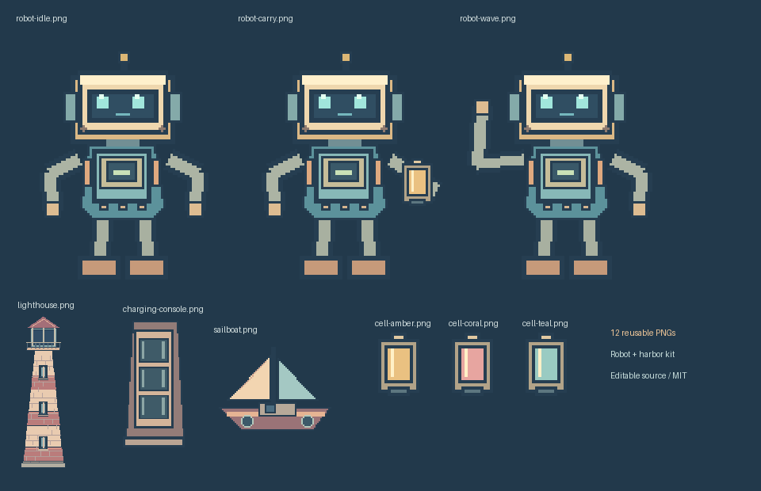

**目的**：让使用者直接复用新的机器人、海港和道具素材，而不依赖兔子造型或原电脑文件。

# 海港机器人 · 原创像素素材包



12个PNG，采用仓库MIT许可；均由[可编辑绘图源码](../../../tools/harbor_assets.py)生成，不使用外部图片、字体、模型API或兔子绘图代码。背景为360×640，角色与道具保留透明通道。

| 文件 | 用途 |
|---|---|
| robot-idle.png / robot-carry.png / robot-wave.png | 站立、搬运、挥手三种完整姿态，可独立用于新的分镜或合成 |
| robot-head.png / robot-body.png | 拆分角色部件，供动作实现复用；当前短片的关节手臂与腿由渲染代码绘制 |
| lighthouse.png | 不发光的灯塔本体；透镜与光束由场景按通电状态叠加 |
| charging-console.png | 三槽充电控制台 |
| cell-amber.png / cell-coral.png / cell-teal.png | 三枚身份固定的电池；可单独搬运、安装和复用 |
| sailboat.png | 可独立移动的归航渔船，旗帜与水纹由场景补充 |
| harbor-background.png | 海港、远山、码头和海面；不包含机器人、灯塔和渔船主体 |

文件尺寸与SHA见[manifest.json](manifest.json)。[海港短片](../../../examples/harbor/README.md)实际读取这些PNG，不是只放几张图片做展示。

需要修改或重新导出素材，在新目录运行：

```bash
python tools/harbor_assets.py --out outputs/my-harbor-kit
```

工具拒绝覆盖已有目录。自定义素材包可先在新作品中适配；正式替换包内素材时必须同步manifest及检查记录。不要只改PNG后绕过校验。

这12张PNG属于一套角色与场景素材，三种姿态不是三种独立角色。它们可以参与新故事，当前现成剧情仍是[机器人点亮灯塔](../../../examples/harbor/README.md)，其他剧情需要AI适配分镜与动画实现。
