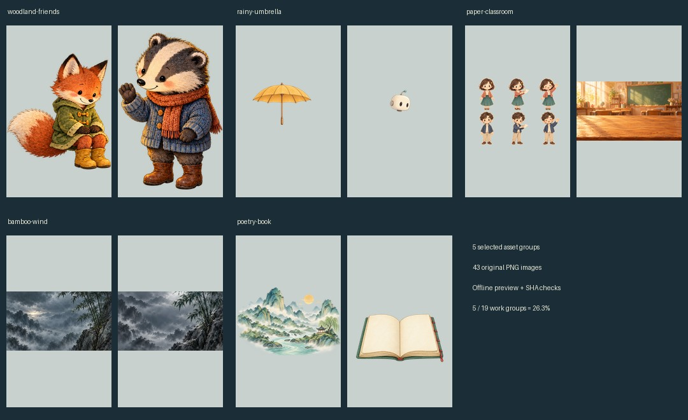
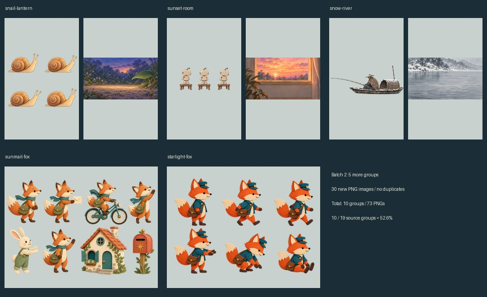

**目的**：帮助下载者选择并复用维护者既有制作中的静图素材，明确素材、图集和可运行影片的区别。

# 既有制作素材精选



已分两批从19个含静图的作品素材分组中各选5组，每批约26.3%。累计10组、73张PNG、77,324,985字节（73.74MiB），占原19组约52.6%。按作品组统计，不是全部42作品、文件数或字节量的两次25%；未为数量凑入缓存帧或历史失败版本。

## 第一批：5组43图

| 素材包 | 图片数 | 用途 |
|---|---:|---|
| [狐狸与獾](woodland-friends/README.md) | 21 | 水彩角色拆件、姿态、罐子、村庄/室内背景 |
| [撑伞机器人与小鸟](rainy-umbrella/README.md) | 10 | 背景、雨伞、身体/手臂/头与小鸟 |
| [纸艺少年与教室](paper-classroom/README.md) | 3 | 男女孩角色/动作图集、教室背景 |
| [竹林与山岩](bamboo-wind/README.md) | 2 | 无字水墨远景/近景 |
| [山水与书本](poetry-book/README.md) | 7 | 三状态书本、透明山水、纸面与原图集 |

## 第二批：新增5组30图



| 素材包 | 图片数 | 用途 |
|---|---:|---|
| [蜗牛与灯光](snail-lantern/README.md) | 18 | 暮色背景、机器人/蜗牛原图集和单姿态、地面光 |
| [晚霞房间](sunset-room/README.md) | 8 | A款机器人参考、推凳/走路/背向姿态、凳子与房间 |
| [雪江渔舟](snow-river/README.md) | 2 | 无字雪江背景、独立渔舟 |
| [太阳邮差狐狸](sunmail-fox/README.md) | 1 | 角色/道具图集及不等宽主体裁切框 |
| [星光邮差狐狸](starlight-fox/README.md) | 1 | 6姿态狐狸图集及分格参数 |

第二批30图按SHA检查，与第一批43图不重复。两个邮差狐狸外观不同，新故事应固定所选角色身份。图集只是一个图像文件，不把格内姿态计作独立PNG；相同原图在其他历史作品中的复用副本不重复发布。

## 下载后怎么用

从仓库根安装requirements.txt后：

```bash
python tools/asset_library.py list
python tools/asset_library.py verify
python tools/asset_library.py preview --pack woodland-friends --out outputs/woodland-preview.png
```

preview生成静态资产联系表，不是视频；输出文件必须是新的，不覆盖旧结果。命令从脚本位置找素材，可从其他工作目录调用绝对脚本路径。verify核图片字节/SHA/尺寸与解码，不判断动作自然度或艺术采用。

可以对AI说：“使用woodland-friends里的狐狸与獾，复用包内素材和原创音乐，设计一个新故事。先给分镜和代表段，再做全片。”AI须核对完整姿态、身体拆件、图集和背景的具体用途，沿[工作流](../../workflows/README.md)适配动作与合成；这些图片不是现成骨骼、自动口型或任意故事引擎。当前默认新人[海港机器人](../../examples/harbor/README.md)不变，导入素材不等于为每组新增一个完整影片渲染器。

## 来源与许可

素材来自维护者既有动画项目的内置imagegen原创画面及制作拆件，本次公开PNG与源图逐字节一致，保留原透明通道和画布。每组manifest记录源作品题名、尺寸、source_sha256与公开sha256；源项目原件未修改。未包含第三方参考图/视频、原曲、配音、字体、原始会话或账户记录。图片可能仍为未采用的创作候选，公开不代表艺术验收。

本批图片随本仓库按[MIT许可](../../LICENSE)发布；未导入的其他本地资料、外部参考内容不因此获得许可。目录机器入口见[catalog.json](catalog.json)。生成新素材或改写动画仍可能消耗对话Token或外部服务费用；运行列表、校验和预览本身不调用AI服务。

返回：[项目入口](../../README.md)。
