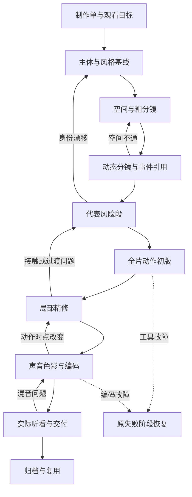

**目的**：表达短片阶段依赖、局部退回和真实采用状态。

# 短片制作依赖图

节点使用NOT_STARTED、IN_PROGRESS、REVIEW_PENDING、ACCEPTED、REWORK_REQUIRED、BLOCKED；每项绑定具体产物版本、前置结果和检查/反馈范围。文件存在或技术通过不代表用户采用，旧版本通过不自动授予新版本状态。

恢复时只展开就绪节点，保留未失效的完成前缀；返工仅使真实依赖失效，不能无故把全图重置。新路线可按目标合并阶段；无角色的绘画探索不强制角色表演。图不要求每个节点都停下来重复问许可。

实际节点交接沿[相邻Loop/阶段接口](../loops/README.md)，预算、位置和收束结果同样返回；记录沿[现有项目结构](../templates/project/README.md)。本图只是关系合同，不自动运行节点。
